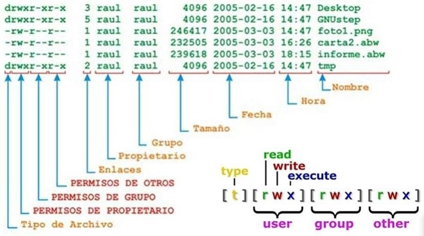
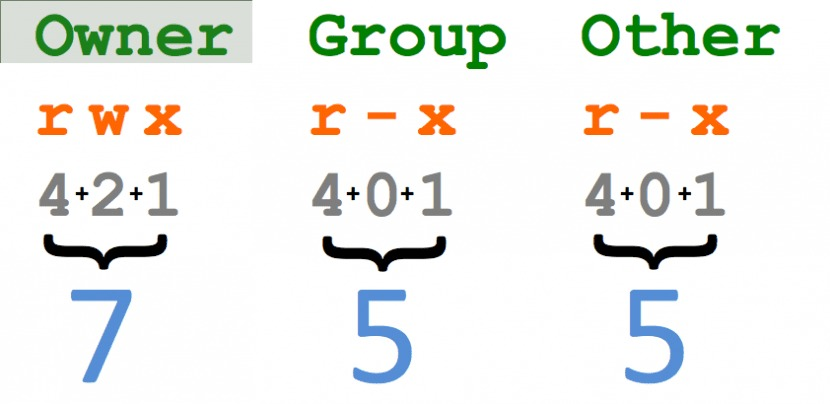

Ubuntu y GitHub
=====================

Instalación de Ubuntu
---------------------

| Para el funcionamiento de ROS2 es necesario instalar Ubuntu.
| En este curso trabajaremos con **Ubuntu 24.04** y **ROS Jazzy**.

**Recursos de descarga**

- **Imagen ISO Ubuntu 24.04:**
  `Descarga Oficial <https://releases.ubuntu.com/24.04/>`__

**Instalación recomendada**

Para las prácticas del manipulador se recomienda instalar Ubuntu 24.04 LTS
nativamente, de modo que RViz 2, los periféricos y la aceleración gráfica
puedan utilizar los recursos del equipo. Sigue las instrucciones oficiales
de Ubuntu y verifica que la versión instalada sea 24.04 antes de continuar.

- `Guía oficial de instalación de Ubuntu Desktop
  <https://documentation.ubuntu.com/desktop/en/latest/tutorial/install-ubuntu-desktop/>`__.

**Verificación de instalación de Python**

Una vez dentro de Ubuntu, abre una terminal y ejecuta:

.. code:: bash

   python3 --version

Debe mostrarse algo como ``Python 3.12.x``, que es la versión por
defecto en Ubuntu 24.04.

Introducción a Ubuntu
---------------------

**Ubuntu** es una distribución del sistema operativo **GNU/Linux**
basada en **Debian**. Es una de las distribuciones más populares por su
facilidad de uso, estabilidad y fuerte comunidad. Se utiliza ampliamente
en servidores, entornos de desarrollo, sistemas embebidos, ciencia y
escritorios personales.

Usos comunes de Ubuntu:

- Desarrollo de software (Python, C++, ROS 2, Web)
- Educación y simulación (Gazebo, R)
- Administración de sistemas y redes (SSH, Docker, servidores web)
- Automatización de tareas con Bash scripting
- Entornos gráficos personalizados y ligeros

La siguiente bibliogradía aborda más a detalle el uso básico de linux

`Linux
Essentials <https://learning.lpi.org/es/learning-materials/010-160/>`__

`Web Development
Essentials <https://learning.lpi.org/es/learning-materials/030-100/>`__

Comandos básicos de Linux
~~~~~~~~~~~~~~~~~~~~~~~~~

En general los comandos en ubuntu siguen la siguiente extructura:

::

   comando (opciones) (argumentos)

Aquí algunos comandos fundamentales que debes dominar:

**1. Gestion de arhivos y directorios**

-ls: Lista archivos y directorios.

::

   ls -l # muestra una lista detallada con permisos, propietarios, tamaño, etc.

- cd: Cambia de directorio.

::

   cd /home/ # te lleva al directorio Home.

- mkdir: Crea un nuevo directorio.

::

   mkdir nuevo_directorio.

- rm: Elimina archivos o directorios.

::

   rm archivo.txt # elimina el archivo archivo.txt.

::

   rm -r carpeta # elimina una carpeta y su contenido.

- cp: Copia archivos o directorios.

::

   cp archivo1.txt archivo2.txt # copia el archivo archivo1.txt en archivo2.txt.

- mv: Mueve o renombra archivos y directorios.

::

   mv archivo.txt /ruta/destino # mueve un archivo a una nueva ubicación.

**2. Permisos y gestión de usuarios:**

Los diferentes directorios poseen niveles de manipulación que son:

De manera decimal tenemos:

los comandos que permiten modificar los permisos de directorios son:

- chmod: Cambia los permisos de archivos y directorios.

::

   chmod 755 archivo.sh # otorga permisos de lectura, escritura y ejecución al propietario, y solo lectura y ejecución al resto.

**3. Gestión de procesos:**

- ps: Muestra los procesos activos.

::

   ps aux # lista todos los procesos.

- top: Muestra los procesos en ejecución y su uso de recursos.

- kill: Termina un proceso específico.

::

   kill 1234 # termina el proceso con el PID 1234.

**4. Instalación de paquetes y software:**

- apt: Usado para gestionar paquetes en distribuciones basadas en Debian
  (como Ubuntu).

::

   sudo apt install ros-jazzy-desktop # instala la versión Jazzy de ROS2.

- snap: Sistema para instalar paquetes universales.

::

   sudo snap install nombre_paquete.

**5. SSH (Secure Shell):** 

SSH permite acceso remoto seguro a otra máquina, útil cuando trabajas con robots o servidores de
manera remota. estructura: 

::

   ssh usuario@ip_del_servidor 

Ejemplo:

::

   ssh usuario@192.168.1.100  # conecta a una máquina con esa IP.

- Transferir archivos vía SSH (SCP):

::

   scp archivo.txt usuario@192.168.1.100:/ruta/destino  # Copia archivos a una máquina remota.

**6. Gestión de red:**

- ip: Muestra la configuración de red mediante ``ip addr``.

- ping: Prueba la conexión a otra máquina.

::

   ping google.com # verifica si hay conexión con Google.

::
   ss -tulnp # Muestra sockets TCP/UDP en escucha.

- UFW (Uncomplicated Firewall): Firewall básico en Ubuntu.

::

   sudo ufw status #Ver el estado del firewall.

::

   sudo ufw enable #Habilitar el firewall.

::

   sudo ufw allow 22 #Permitir conexiones SSH (puerto 22).

::

   # ROS 2 usa DDS, no el puerto 11311 de ROS 1.
   # Revisa la política de red y los puertos DDS de tu RMW antes de abrir el firewall.

--------------

GitHub
------

GitHub es una plataforma de control de versiones basada en Git que
permite almacenar, compartir y colaborar en código fuente. Es ideal para
proyectos ROS, especialmente al trabajar en equipos o distribuir
paquetes.

Comandos básicos de Git
~~~~~~~~~~~~~~~~~~~~~~~

.. code:: bash

   # Configurar usuario
   git config --global user.name "Tu Nombre"
   git config --global user.email "tu_correo@example.com"

   # Clonar un repositorio
   git clone https://github.com/usuario/repositorio.git

   # Crear y subir cambios
   git add .
   git commit -m "Descripción del cambio"
   git push origin main

   # Sincronizar cambios
   git pull origin main

Tutorial de uso de Git y GitHub
`tutorial <https://www.youtube.com/watch?v=mBYSUUnMt9M&t=14612s>`__
