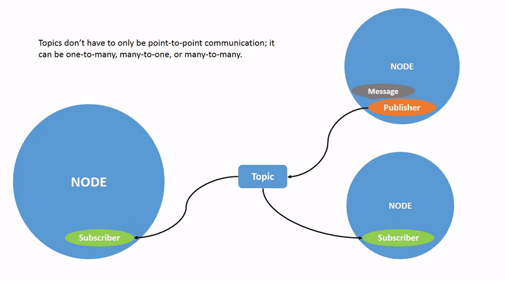
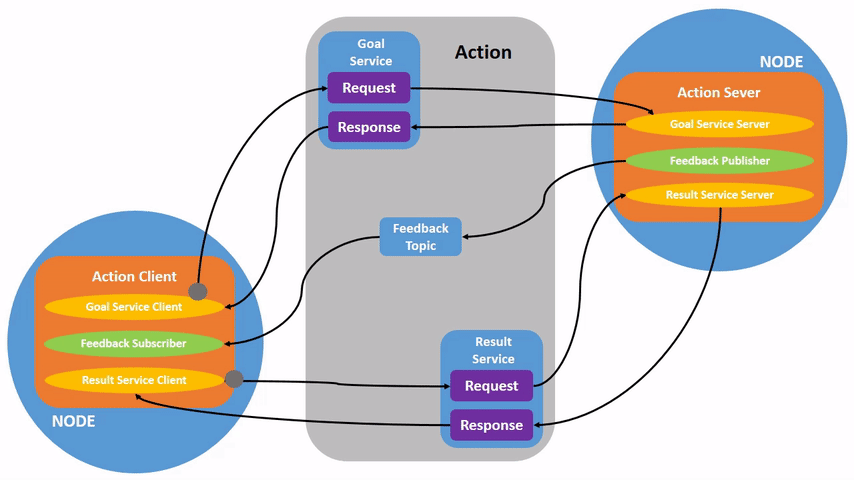
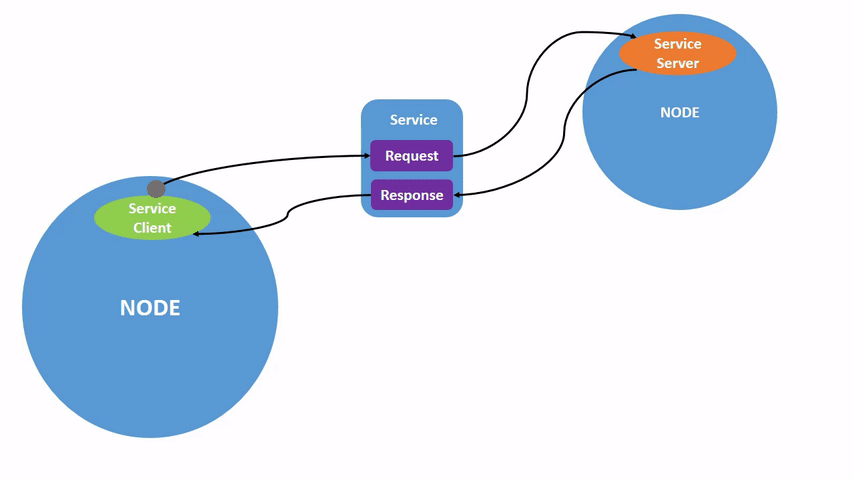

Conceptos Básicos
=================

Espacio de trabajo
------------------

¿Qué es un espacio de trabajo en ROS 2?

Un **espacio de trabajo (workspace)** en ROS 2 es una carpeta
estructurada que contiene paquetes ROS 2, los cuales pueden estar
escritos en Python o C++. Todos los paquetes se compilan y organizan
dentro del workspace.

**¿Qué es colcon?**

``colcon`` es la herramienta oficial y recomendada para **construir,
compilar y organizar workspaces en ROS 2**.

Proviene de “COmplex LOgic CONstructor” y fue diseñado para reemplazar
herramientas anteriores como ``catkin_make`` o ``ament_tools``.

**Características de colcon**

- Compila múltiples paquetes de forma **paralela**.
- Detecta **dependencias entre paquetes** y respeta el orden de
  compilación.
- Separa los archivos construidos en carpetas específicas.
- Es **extensible** mediante plugins.

Instalación de colcon y extensiones recomendadas

.. code:: bash

   sudo apt install python3-colcon-common-extensions

**Comandos principales de colcon**

+----------------------------------------------------+-----------------+
| Comando                                            | ¿Qué hace?      |
+====================================================+=================+
| ``colcon build``                                   | Compila todos   |
|                                                    | los paquetes en |
|                                                    | ``src/``        |
+----------------------------------------------------+-----------------+
| ``colcon build --packages-select nombre``          | Compila solo un |
|                                                    | paquete         |
|                                                    | específico      |
+----------------------------------------------------+-----------------+
| ``colcon list``                                    | Muestra todos   |
|                                                    | los paquetes    |
|                                                    | del workspace   |
+----------------------------------------------------+-----------------+
| ``colcon test``                                    | Ejecuta pruebas |
|                                                    | definidas en    |
|                                                    | los paquetes    |
+----------------------------------------------------+-----------------+
| ``colcon build --symlink-install``                 | En paquetes     |
|                                                    | Python, enlaza  |
|                                                    | código para no  |
|                                                    | recompilar cada |
|                                                    | vez             |
+----------------------------------------------------+-----------------+

**Directorios creados por colcon al compilar**

Al ejecutar ``colcon build``, se generan 3 carpetas principales:

::

   ros2_ws/
   ├── build/
   ├── install/
   └── log/

+--------------------------+-------------------------------------------+
| Carpeta                  | ¿Para qué sirve?                          |
+==========================+===========================================+
| ``build/``               | Archivos temporales de compilación. ROS 2 |
|                          | genera aquí el código intermedio.         |
+--------------------------+-------------------------------------------+
| ``install/``             | Aquí se instalan los ejecutables,         |
|                          | scripts, bibliotecas y archivos           |
|                          | generados. Es lo que usas con             |
|                          | ``source install/setup.bash``.            |
+--------------------------+-------------------------------------------+
| ``log/``                 | Archivos de salida, advertencias y        |
|                          | errores de compilación. Útil para         |
|                          | depuración.                               |
+--------------------------+-------------------------------------------+

**Limpieza de la build**

Si es necesario limpiar el workspace por completo:

.. code:: bash

   colcon build --packages-select my_package --cmake-clean-cache

O para limpiar todo:

.. code:: bash

   rm -rf build/ install/ log/

Paquetes
--------

**¿Qué son los paquetes?**

Un paquete es la unidad mínima de construcción en ROS 2. Contiene código
fuente, archivos de lanzamiento, configuraciones, y puede ser en Python
o C++.

¿Qué tipos de paquetes existen?

- ``ament_cmake`` → para paquetes en C++
- ``ament_python`` → para paquetes en Python

**Diferencias entre paquetes en Python y C++**

============== ===================== ===========================
Característica C++ (``ament_cmake``) Python (``ament_python``)
============== ===================== ===========================
Compilación    Requiere CMake        No necesita compilar código
setup.py       No usa                Obligatorio
Velocidad      Más rápida            Más simple de escribir
============== ===================== ===========================

**Crear un paquete Python desde cero**

Para crear un paquete usamos el comando ``ros2 pkg create`` y añadiños
las siguientes argumentos :

**Descripción de opciones:**

+------------------------------+---------------------------------------+
| Parte                        | Función                               |
+==============================+=======================================+
| ``my_package``               | Nombre del paquete                    |
+------------------------------+---------------------------------------+
| ``--build-type``             | Define el tipo de compilador          |
+------------------------------+---------------------------------------+
| ``--license``                | Agrega la licencia al package.xml     |
+------------------------------+---------------------------------------+
| ``--node-name``              | No crea nodo por defecto, se ignora   |
|                              | usualmente                            |
+------------------------------+---------------------------------------+
| ``--description``            | Agrega la descripción del paquete, se |
|                              | ignora usualmente                     |
+------------------------------+---------------------------------------+

--------------

**Resumen para crear un paquete Python completo**

.. code:: bash

   ros2 pkg create py_listener_pkg \
     --build-type ament_python \
     --dependencies rclpy std_msgs \
     --license "MIT" \
     --description "Paquete de ejemplo en Python para suscripción ROS 2"

Organización de los archivos del paquete
~~~~~~~~~~~~~~~~~~~~~~~~~~~~~~~~~~~~~~~~~~~~~

El siguiente árbol es **ilustrativo**.

.. code-block:: text

   ~/ros2_ws/src/
   ├── avig_msg/                         # Interfaces personalizadas existentes
   │   └── action/
   │       └── MoverA.action
   └── mi_pkg_python/
       ├── package.xml                  # Dependencias del paquete ROS 2
       ├── setup.py                     # Registro de módulos ejecutables
       ├── setup.cfg                    # Directorio de scripts instalados
       ├── resource/
       │   └── mi_pkg_python            # Marcador ament
       ├── launch/
       │   └── ejemplo_nodos.launch.py  # Lanzamiento opcional
       └── mi_pkg_python/
           ├── __init__.py
           ├── estructura_nodo.py
           ├── estructura_publicador.py

**Funciones de los archivos:**

* ``package.xml``: identifica el paquete y declara las dependencias de ROS 2.
* ``setup.py``: instala los módulos y asigna nombres de ejecutables para ``ros2 run``.
* ``setup.cfg``: indica dónde instalar los ejecutables de Python.
* ``mi_pkg_python/__init__.py``: identifica el directorio como paquete Python.
* ``launch/*.launch.py``: permite iniciar y configurar uno o varios nodos.
* ``avig_msg``: contiene las definiciones de interfaces propias; se mantiene
  independiente del paquete Python según la estructura actual del curso.

Nodos
------

Un **nodo** es una entidad computacional que ejecuta una función
específica, como mover un robot móvil simulado, leer sensores, o calcular
trayectorias.

Un nodo escrito con ``rclpy`` sigue normalmente seis pasos:

#. **Importar bibliotecas** de Python y ROS 2.
#. **Definir una clase** que herede de ``Node``.
#. **Llamar al constructor** de ``Node`` mediante ``super().__init__()``.
#. **Crear las interfaces** que necesite (si las hay).
#. **Definir los callbacks** que ejecutarán la lógica.
#. **Crear ``main()``** para inicializar, procesar y finalizar ROS 2.

.. code-block:: python
   :caption: mi_pkg_python/estructura_nodo.py

   # 1. Bibliotecas necesarias para crear un nodo ROS 2.
   import rclpy
   from rclpy.node import Node

   # 2. La clase del programa hereda de Node.
   class NodoBasico(Node):

      # 3. El constructor configura el nodo una sola vez.
      def __init__(self):
         super().__init__('nodo_basico')  # Nombre visible con ros2 node list.
         self.get_logger().info('Nodo iniciado correctamente.')
         # 4. Aquí se crearían publicadores, suscripciones, etc.
         # 5. Aquí se declararían los parámetros y estados necesarios.

   # 6. Punto de entrada del proceso.
   def main(args=None):
      rclpy.init(args=args)               # Inicializar el contexto ROS 2.
      node = NodoBasico()                 # Construir el nodo.

      try:
         rclpy.spin(node)                # Atender callbacks hasta detenerlo.
      except KeyboardInterrupt:
         pass
      finally:
         node.destroy_node()            # Liberar las interfaces del nodo.
         if rclpy.ok():
            rclpy.shutdown()           # Finalizar el contexto ROS 2.

   if __name__ == '__main__':
      main()

Significado de los elementos de Python
~~~~~~~~~~~~~~~~~~~~~~~~~~~~~~~~~~~~~~~

.. list-table:: Lectura del código
   :header-rows: 1
   :widths: 32 68

   * - Elemento
     - Significado
   * - ``class MiNodo(Node):``
     - Define una clase que hereda las funciones de un nodo ROS 2.
   * - ``def __init__(self):``
     - Constructor que se ejecuta al instanciar el objeto.
   * - ``super().__init__('nombre')``
     - Inicializa la parte ``Node`` heredada y registra el nombre del nodo.
   * - ``self``
     - Referencia a la instancia; permite acceder a sus variables y métodos.
   * - ``self.create_publisher(...)``
     - Llama a un método de ``Node`` que crea una entidad publicadora.
   * - ``self.callback``
     - Referencia al método que será invocado cuando ocurra un evento.
   * - ``rclpy.init()``
     - Inicializa los recursos necesarios del cliente ROS 2.
   * - ``rclpy.spin()``
     - Procesa eventos, mensajes, timers y respuestas por medio del executor.
   * - ``node.destroy_node()``
     - Libera el nodo y sus entidades.
   * - ``if __name__ == '__main__':``
     - Ejecuta ``main()`` si se inicia el archivo directamente.

.. note::

   ``rclpy.spin(node)`` se utiliza cuando el nodo debe permanecer atendiendo
   eventos. Si un programa de propósito puntual solo realiza una operación,
   puede utilizar otro patrón de ejecución, pero siempre debe gestionar
   correctamente la inicialización y el cierre.

Ejemplo: 

- ``turtlesim_node``: renderiza la tortuga y ejecuta sus acciones. 
- ``turtle_teleop_key``: interpreta teclas y publica comandos de velocidad. 
- ``teleop_twist_keyboard``: interpreta teclas y publica comandos de velocidad.

Listar nodos activos:

.. code:: bash

   ros2 node list

Publicadores y suscriptores: comunicación por tópicos
--------------------------------------------------------

En una comunicación por tópicos, el publicador envía mensajes y uno o varios
suscriptores pueden recibirlos. **El nombre del tópico, el tipo de mensaje y
la compatibilidad de QoS** deben coincidir para que exista intercambio.

   Tomado de: ROS 2 Jazzy - Documentación Oficial

Estructura del publicador
~~~~~~~~~~~~~~~~~~~~~~~~~~

Un publicador necesita **crear un objeto publicador**, **construir un mensaje**
y **publicarlo**. Si el envío es periódico, suele utilizarse un temporizador.

.. code-block:: python
   :caption: mi_pkg_python/estructura_publicador.py

   import rclpy
   from rclpy.node import Node
   from std_msgs.msg import String  # Tipo que contiene un campo data.

   class PublicadorClase(Node):
      def __init__(self):
         super().__init__('publicador_clase')

         # Tipo, nombre del tópico y profundidad de la cola (QoS).
         self.publisher_ = self.create_publisher(String, 'topic', 10)

         # El callback se ejecutará cada 0.5 segundos.
         self.timer = self.create_timer(0.5, self.timer_callback)
         self.contador = 0

      def timer_callback(self):
         mensaje = String()                    # Crear el mensaje.
         mensaje.data = f'Mensaje {self.contador}'
         self.publisher_.publish(mensaje)      # Enviar al tópico.
         self.get_logger().info(mensaje.data)
         self.contador += 1

   def main(args=None):
      rclpy.init(args=args)
      node = PublicadorClase()
      try:
         rclpy.spin(node)
      except KeyboardInterrupt:
         pass
      finally:
         node.destroy_node()
         if rclpy.ok():
            rclpy.shutdown()

   if __name__ == '__main__':
      main()

``create_publisher()`` no publica por sí mismo: solo crea la interfaz. La
publicación se realiza con ``publish(mensaje)``. En este caso, el temporizador
es el mecanismo que desencadena cada envío.

Estructura del suscriptor
~~~~~~~~~~~~~~~~~~~~~~~~~~

El suscriptor necesita crear una suscripción y registrar un **callback** que
reciba un mensaje del tipo configurado.

.. code-block:: python
   :caption: mi_pkg_python/estructura_suscriptor.py

   import rclpy
   from rclpy.node import Node
   from std_msgs.msg import String

   class SuscriptorClase(Node):
      def __init__(self):
         super().__init__('suscriptor_clase')

         # Guardar la suscripción en un atributo de la instancia.
         self.subscription = self.create_subscription(
            String, 'topic', self.listener_callback, 10
         )

      def listener_callback(self, msg):
         # Se ejecuta por cada mensaje recibido de 'topic'.
         self.get_logger().info(f'Recibido: {msg.data}')

   def main(args=None):
      rclpy.init(args=args)
      node = SuscriptorClase()
      try:
         rclpy.spin(node)
      except KeyboardInterrupt:
         pass
      finally:
         node.destroy_node()
         if rclpy.ok():
            rclpy.shutdown()

   if __name__ == '__main__':
      main()

Ejemplos de ROS2: 

- ``/turtle1/cmd_vel``: donde se publican los comandos de velocidad lineal y angular. 

- ``/turtle1/pose``: donde se publica la posición actual de la tortuga.

Ver temas activos:

.. code:: bash

   ros2 topic list

En este ejemplo se muestra cómo lanzar el nodo de ``turtlesim`` y
controlar su movimiento mediante el teclado. También se explica cómo
utilizar otro nodo de teleoperación genérico (``teleop_twist_keyboard``)
haciendo uso de **remapeo de temas** en ROS 2.

**1: Instalación de paquetes necesarios**

.. code:: bash

   sudo apt update
   sudo apt install ros-jazzy-turtlesim ros-jazzy-teleop-twist-keyboard

**2: Lanzar la ventana del simulador**

.. code:: bash

   ros2 run turtlesim turtlesim_node

Este comando lanza el nodo que genera la ventana de simulación con la
tortuga inicial (``/turtle1``).

**3: Controlar la tortuga con el teclado (teleop integrado)**

.. code:: bash

   ros2 run turtlesim turtle_teleop_key

**4: Control con un nodo genérico de teleoperación**

En este ejemplo se usa el nodo ``teleop_twist_keyboard`` del paquete
``teleop_twist_keyboard``. Este nodo: Lee las teclas del teclado y 
publica mensajes del tipo ``geometry_msgs/msg/Twist``

.. code:: bash

   ros2 run teleop_twist_keyboard teleop_twist_keyboard

Por defecto, este nodo publica en el tema:

::

   /cmd_vel

Sin embargo, en ``turtlesim``, la tortuga escucha comandos en:

::

   /turtle1/cmd_vel

**¿Cómo solucionar esto?**

Remapeo de temas
~~~~~~~~~~~~~~~~

ROS 2 permite redirigir (“remapear”) los nombres de los temas **sin
necesidad de cambiar el código** del nodo. Para hacerlo se usa:

.. code:: bash

   --ros-args -r [tema_origen]:=[tema_destino]

En este caso específico:

.. code:: bash

   ros2 run teleop_twist_keyboard teleop_twist_keyboard --ros-args -r cmd_vel:=/turtle1/cmd_vel

Esto se entiende como:

   “Cuando este nodo publique en ``/cmd_vel``, en realidad envíalo a
   ``/turtle1/cmd_vel``.”

--------------

¿Por qué es útil el remapeo?

- Evita modificar el código fuente de los nodos.
- Permite **reutilizar nodos genéricos** con distintos robots o
  simuladores.
- Facilita pruebas rápidas con distintos sistemas.

Servicios
---------

Un **servicio** en ROS 2 es una operación remota que sigue un patrón de
**llamada y respuesta** (request-response).

**Componentes de un servicio:**

- **Cliente**: el nodo que inicia la solicitud.
- **Servidor**: el nodo que atiende la solicitud y envía la respuesta.
- **Tipo de servicio**: define la estructura de los datos solicitados y
  respondidos.

**Estructura de un Servicio**

Los servicios están definidos por archivos ``.srv``, que contienen dos
partes separadas por ``---``:

::

   # Ejemplo: example_interfaces/srv/AddTwoInts

   int64 a
   int64 b
   ---
   int64 sum

Esto significa que: 

- El **cliente** enviará dos enteros ``a`` y ``b`` 

- El **servidor** responderá con un entero ``sum``

**Comunicación Cliente-Servidor**

La interacción funciona así: |Seleccion| *Tomado de: ROS 2 Jazzy - Documentación Oficial*

Servidor de servicio
~~~~~~~~~~~~~~~~~~~~~

Un servidor necesita declarar el tipo ``.srv``, registrar el **nombre del
servicio** y proporcionar un callback que reciba ``request`` y ``response``.

.. code-block:: python
   :caption: mi_pkg_python/estructura_servidor_srv.py

   import rclpy
   from rclpy.node import Node
   from example_interfaces.srv import AddTwoInts

   class ServidorSuma(Node):

      def __init__(self):
         super().__init__('servidor_suma')

         # Tipo de servicio, nombre y callback que responde solicitudes.
         self.srv = self.create_service(
            AddTwoInts, 'sumar_dos_enteros', self.sumar_callback
         )
         self.get_logger().info('Servicio /sumar_dos_enteros disponible.')

      def sumar_callback(self, request, response):
         # request contiene los campos definidos ANTES de ---.
         # response contiene los campos definidos DESPUÉS de ---.
         response.sum = request.a + request.b
         self.get_logger().info(f'{request.a} + {request.b} = {response.sum}')
         return response  # Siempre devolver la respuesta tipada.

   def main(args=None):
      rclpy.init(args=args)
      node = ServidorSuma()
      try:
         rclpy.spin(node)
      except KeyboardInterrupt:
         pass
      finally:
         node.destroy_node()
         if rclpy.ok():
            rclpy.shutdown()

   if __name__ == '__main__':
      main()

Cliente de servicio asíncrono
~~~~~~~~~~~~~~~~~~~~~~~~~~~~~~

El cliente debe crear una entidad ``Client``, construir un objeto ``Request``
y llamar a ``call_async()``. La operación devuelve un **Future**, que es un
objeto que permite obtener la respuesta cuando haya terminado.

.. code-block:: python
   :caption: mi_pkg_python/estructura_cliente_srv.py

   import rclpy
   from rclpy.node import Node
   from example_interfaces.srv import AddTwoInts

   class ClienteSuma(Node):
      def __init__(self):
         super().__init__('cliente_suma')

         # El nombre y el tipo deben coincidir con los del servidor.
         self.cli = self.create_client(AddTwoInts, 'sumar_dos_enteros')

      def enviar_solicitud(self, a, b):
         # Esperar de forma acotada hasta que exista un servidor.
         if not self.cli.wait_for_service(timeout_sec=5.0):
            self.get_logger().error('Servicio no disponible.')
            return None

         solicitud = AddTwoInts.Request()
         solicitud.a = int(a)
         solicitud.b = int(b)

         # call_async() devuelve inmediatamente un Future.
         return self.cli.call_async(solicitud)

   def main(args=None):
      rclpy.init(args=args)
      node = ClienteSuma()
      try:
         futuro = node.enviar_solicitud(5, 7)
         if futuro is not None:
            # Es válido aquí: estamos en main(), SIN otro spin activo.
            rclpy.spin_until_future_complete(node, futuro)
            if futuro.exception() is not None:
               node.get_logger().error(str(futuro.exception()))
            else:
               resultado = futuro.result()
               node.get_logger().info(f'Suma recibida: {resultado.sum}')
      except KeyboardInterrupt:
         pass
      finally:
         node.destroy_node()
         if rclpy.ok():
            rclpy.shutdown()

   if __name__ == '__main__':
      main()

Comprobación del servicio
~~~~~~~~~~~~~~~~~~~~~~~~~~

.. code-block:: bash

   # Terminal 1: servidor
   ros2 run mi_pkg_python estructura_servidor_srv

   # Terminal 2: cliente
   ros2 run mi_pkg_python estructura_cliente_srv

   # Alternativa: invocar el servicio desde la terminal.
   ros2 service list -t
   ros2 service type /sumar_dos_enteros
   ros2 interface show example_interfaces/srv/AddTwoInts
   ros2 service call /sumar_dos_enteros example_interfaces/srv/AddTwoInts \
     "{a: 5, b: 7}"

**¿Cuándo usar un Servicio?**

====================================== ================
Situación                              Usar Servicio
====================================== ================
Encender o apagar un dispositivo       ✅
Calcular una operación matemática      ✅
Consultar el estado de un sistema      ✅
Recibir datos periódicos (sensor, etc) ❌ (usar tópico)
Ejecutar tareas con duración variable  ❌ (usar acción)
====================================== ================

**Ventajas del uso de servicios**

- Comunicación clara de solicitud y respuesta.
- Ideal para operaciones atómicas.
- Bajo acoplamiento: los nodos solo necesitan conocer el tipo del
  servicio.
- Facilita control de errores: se sabe si hubo respuesta o no.

**Consideraciones técnicas**

- La espera por la respuesta puede bloquear el nodo (sin ``async``).
- Los servicios **no están diseñados** para flujos continuos de datos.
- Si necesitas emitir múltiples respuestas a una sola solicitud → usa
  **acciones**.

**Ejemplos de servicios comunes en ROS 2**

+----------------------+---------------------------------------+-----------------------+
| Servicio             | Tipo                                  | Descripción           |
+======================+=======================================+=======================+
| ``/clear``           | ``std_srvs/Empty``                    | Borrar pantalla de    |
|                      |                                       | simuladores como      |
|                      |                                       | turtlesim             |
+----------------------+---------------------------------------+-----------------------+
| ``/reset``           | ``std_srvs/Empty``                    | Reiniciar el estado   |
|                      |                                       | de un nodo            |
+----------------------+---------------------------------------+-----------------------+
| ``/add_two_ints``    | ``example_interfaces/srv/AddTwoInts`` | Sumar dos números     |
+----------------------+---------------------------------------+-----------------------+
| ``/spawn``           | ``turtlesim/srv/Spawn``               | Crear nueva tortuga   |
| (turtlesim)          |                                       |                       |
+----------------------+---------------------------------------+-----------------------+

**Comandos útiles**

Listar servicios disponibles:

.. code:: bash

   ros2 service list

Ver tipo de un servicio:

.. code:: bash

   ros2 service type /nombre_servicio

Ver definición de un servicio:

.. code:: bash

   ros2 interface show [servicio]

Llamar un servicio desde terminal:

.. code:: bash

   ros2 service call /[servicio] "argumentos"

Acciones
---------

**¿Qué es una Acción en ROS 2?**

En ROS 2, una **acción** (``action``) es una estructura de comunicación
que permite la ejecución de tareas **a largo plazo**, donde se necesita:

- Enviar un **objetivo (goal)** desde un nodo cliente a un nodo
  servidor.
- Recibir **retroalimentación (feedback)** mientras se ejecuta la tarea.
- Obtener un **resultado (result)** cuando finaliza la acción.
- Tener la posibilidad de **cancelar la ejecución** en cualquier
  momento.

**Componentes Clave**

- **Cliente de acción:** Nodo que solicita ejecutar una acción.
- **Servidor de acción:** Nodo que ejecuta la acción y responde con
  resultados o feedback.
- **Goal:** Datos de entrada que representan la tarea.
- **Result:** Salida final cuando se completa la acción.
- **Feedback:** Información de progreso enviada mientras se ejecuta.

**Flujo de Ejecución**

1. El cliente envía un **objetivo (goal)**.
2. El servidor **acepta o rechaza** el objetivo.
3. Si es aceptado, el servidor comienza la ejecución.
4. Se envía **feedback** continuamente.
5. Cuando termina, se envía un **resultado**.
6. El cliente puede **cancelar** la acción si es necesario.´

   Tomado de: ROS 2 Jazzy - Documentación Oficial

**Estructura de un action**

En este repositorio se utiliza de ejemplo un action personalizado ``MoverA``:

::

   # Objetivo
   float32 x_actual
   float32 y_actual
   float32 x_meta
   float32 y_meta
   ---
   # Resultado
   bool success
   ---
   # Feedback
   float32 distancia_restante

Partes obligatorias del servidor de acción
~~~~~~~~~~~~~~~~~~~~~~~~~~~~~~~~~~~~~~~~~~~

* **``ActionServer``**: entidad que registra el nombre y tipo de la acción.
* **``goal_callback()``**: acepta o rechaza metas.
* **``execute_callback()``**: ejecuta la tarea, publica feedback y devuelve
  un ``MoverA.Result``.
* **``cancel_callback()``**: acepta o rechaza solicitudes de cancelación.
* **``goal_handle``**: representa una meta concreta y permite consultar su
  cancelación y establecer estados terminales.
* **Executor**: procesa las solicitudes y las tareas concurrentes.

.. code-block:: python
   :caption: Esqueleto didáctico del servidor con cancelación (MoverA)

   import math
   import time

   import rclpy
   from rclpy.node import Node
   from rclpy.action import ActionServer, GoalResponse, CancelResponse
   from rclpy.callback_groups import ReentrantCallbackGroup
   from rclpy.executors import MultiThreadedExecutor
   from avig_msg.action import MoverA

   class ServidorMoverA(Node):
      def __init__(self):
         super().__init__('movera_server')

         # Permite atender una cancelación mientras hay una meta ejecutándose.
         self.grupo = ReentrantCallbackGroup()
         self.servidor = ActionServer(
            self, MoverA, 'mover_a',
            execute_callback=self.execute_callback,
            goal_callback=self.goal_callback,
            cancel_callback=self.cancel_callback,
            callback_group=self.grupo
         )

      def goal_callback(self, goal_request):
         # En un robot físico validaríamos límites y conflictos.
         return GoalResponse.ACCEPT

      def cancel_callback(self, goal_handle):
         # Aceptar cancelar NO marca aún el estado final CANCELED.
         return CancelResponse.ACCEPT

      def execute_callback(self, goal_handle):
         x = float(goal_handle.request.x_actual)
         y = float(goal_handle.request.y_actual)
         meta_x = float(goal_handle.request.x_meta)
         meta_y = float(goal_handle.request.y_meta)
         feedback = MoverA.Feedback()
         resultado = MoverA.Result()

         while rclpy.ok():
            # Verificar cancelación durante la tarea, no solo al comenzar.
            if goal_handle.is_cancel_requested:
               goal_handle.canceled()
               resultado.success = False
               return resultado

            dx, dy = meta_x - x, meta_y - y
            distancia = math.hypot(dx, dy)

            if distancia <= 0.1:       # Tolerancia de llegada.
               goal_handle.succeed()
               resultado.success = True
               return resultado

            # Simulación: avanzar 0.1 unidades hacia la meta.
            paso = min(0.1, distancia)
            x += paso * dx / distancia
            y += paso * dy / distancia

            feedback.distancia_restante = float(
                  math.hypot(meta_x - x, meta_y - y)
            )
            goal_handle.publish_feedback(feedback)
            time.sleep(0.5)            # Solo para el ejercicio educativo.

         if goal_handle.is_active:
            goal_handle.abort()
         resultado.success = False
         return resultado

   def main(args=None):
      rclpy.init(args=args)
      node = ServidorMoverA()
      executor = MultiThreadedExecutor(num_threads=2)
      executor.add_node(node)
      try:
         executor.spin()                # ÚNICO spin del servidor.
      except KeyboardInterrupt:
         pass
      finally:
         executor.shutdown()
         node.destroy_node()
         if rclpy.ok():
            rclpy.shutdown()

   if __name__ == '__main__':
      main()

.. important::

   El programa usa un bucle con ``time.sleep()`` únicamente para representar
   un recorrido 2D **ficticio**. No es un algoritmo de control de motores en
   tiempo real. ``ReentrantCallbackGroup`` permite solapamiento de callbacks;
   en una aplicación que controle un único robot físico sería necesario
   gestionar explícitamente metas simultáneas y condiciones de seguridad.

Partes obligatorias del cliente de acción
~~~~~~~~~~~~~~~~~~~~~~~~~~~~~~~~~~~~~~~~~~

* **``ActionClient``**: registra tipo y nombre de acción.
* **``MoverA.Goal()``**: construye la meta con valores válidos.
* **``send_goal_async()``**: inicia el envío de la meta.
* **``goal_response_callback()``**: comprueba si fue aceptada.
* **``feedback_callback()``**: recibe el progreso; puede activar una
  condición de cancelación.
* **``cancel_goal_async()``**: solicita cancelar una meta aceptada.
* **``get_result_async()``**: obtiene el estado y el resultado final.

.. code-block:: python
   :caption: Esqueleto didáctico del cliente con cancelación (MoverA)

   import rclpy
   from rclpy.node import Node
   from rclpy.action import ActionClient
   from action_msgs.msg import GoalStatus
   from avig_msg.action import MoverA

   class ClienteMoverA(Node):
      def __init__(self):
         super().__init__('movera_client')
         self.cliente = ActionClient(self, MoverA, 'mover_a')
         self.meta = None
         self.cancelacion_solicitada = False
         self.terminado = False

      def enviar_meta(self):
         if not self.cliente.wait_for_server(timeout_sec=5.0):
            self.get_logger().error('No hay servidor de acción disponible.')
            self.terminado = True
            return

         objetivo = MoverA.Goal()
         objetivo.x_actual, objetivo.y_actual = 3.0, 3.0
         objetivo.x_meta, objetivo.y_meta = 0.0, 0.1
         futuro = self.cliente.send_goal_async(
            objetivo, feedback_callback=self.recibir_feedback
         )
         futuro.add_done_callback(self.respuesta_meta)

      def respuesta_meta(self, futuro):
         self.meta = futuro.result()
         if not self.meta.accepted:
            self.get_logger().warn('Meta rechazada.')
            self.terminado = True
            return
         futuro_resultado = self.meta.get_result_async()
         futuro_resultado.add_done_callback(self.recibir_resultado)

      def recibir_feedback(self, mensaje):
         distancia = mensaje.feedback.distancia_restante
         self.get_logger().info(f'Faltan {distancia:.2f} unidades.')

         # Evitar pedir varias veces la misma cancelación.
         if (distancia < 0.8 and self.meta is not None and not self.cancelacion_solicitada):
            self.cancelacion_solicitada = True
            futuro = self.meta.cancel_goal_async()
            futuro.add_done_callback(self.respuesta_cancelacion)

      def respuesta_cancelacion(self, futuro):
         if futuro.result().goals_canceling:
            self.get_logger().info('Cancelación aceptada; espero resultado.')
         else:
            self.get_logger().warn('Cancelación no aceptada.')

      def recibir_resultado(self, futuro):
         respuesta = futuro.result()
         if respuesta.status == GoalStatus.STATUS_CANCELED:
            self.get_logger().info('Acción cancelada.')
         elif respuesta.status == GoalStatus.STATUS_SUCCEEDED:
            self.get_logger().info('Objetivo completado.')
         else:
            self.get_logger().warn('Meta abortada u otro estado final.')
         self.terminado = True

   def main(args=None):
      rclpy.init(args=args)
      node = ClienteMoverA()
      try:
         node.enviar_meta()
         # spin_once está en main(), no dentro de un callback ya en spin.
         while rclpy.ok() and not node.terminado:
            rclpy.spin_once(node, timeout_sec=0.1)
      except KeyboardInterrupt:
         pass
      finally:
         node.destroy_node()
         if rclpy.ok():
            rclpy.shutdown()

   if __name__ == '__main__':
      main()

Diferencia entre estado y resultado
~~~~~~~~~~~~~~~~~~~~~~~~~~~~~~~~~~~~~

.. list-table:: Estados relevantes de una meta
   :header-rows: 1
   :widths: 24 76

   * - Estado
     - Interpretación
   * - ``ACCEPTED``
     - El servidor aceptó la meta; puede estar esperando ejecución.
   * - ``EXECUTING``
     - La tarea está en ejecución.
   * - ``CANCELING``
     - Se aceptó la solicitud de cancelación y aún se está procesando.
   * - ``CANCELED``
     - El servidor marcó la meta como cancelada.
   * - ``SUCCEEDED``
     - El servidor marcó la meta como completada correctamente.
   * - ``ABORTED``
     - El servidor abortó la meta debido a una falla u otra condición.

``resultado.success`` es una variable **definida por nuestra interfaz**.
El estado ``GoalStatus`` pertenece al protocolo de acciones de ROS 2.
**Aceptar cancelar no significa que la meta ya haya terminado**: el cliente
debe esperar el resultado y comprobar ``STATUS_CANCELED``.

Spin, executors y grupos de callbacks
~~~~~~~~~~~~~~~~~~~~~~~~~~~~~~~~~~~~~~

``spin`` atiende callbacks de las entidades de un nodo mediante un executor.
Los grupos de callbacks determinan qué funciones pueden ejecutarse de forma
concurrente.

.. list-table:: Funciones de ejecución en ROS 2 Jazzy
   :header-rows: 1
   :widths: 38 62

   * - API
     - Uso típico
   * - ``rclpy.spin(node)``
     - Mantener activo un nodo sencillo.
   * - ``rclpy.spin_once(node)``
     - Procesar eventos desde un bucle principal que **no esté girando en
       otro executor**.
   * - ``rclpy.spin_until_future_complete(node, futuro)``
     - Esperar una respuesta fuera de callbacks, sin un ``spin`` paralelo.
   * - ``MultiThreadedExecutor``
     - Permitir que diferentes hilos atiendan callbacks del nodo.
   * - ``ReentrantCallbackGroup``
     - Permitir que los callbacks de su grupo puedan solaparse.
   * - ``MutuallyExclusiveCallbackGroup``
     - Evitar ejecución simultánea de callbacks del mismo grupo.

.. warning::

   **Error conocido durante la migración a Jazzy:** la implementación antigua
   del servidor ``MoverA`` llamaba a ``rclpy.spin_once(self)`` **dentro de
   ``execute_callback()``**, mientras el nodo ya estaba ejecutando
   ``rclpy.spin(node)``. En el entorno probado produjo
   ``RuntimeError: Executor is already spinning``. La solución es **no
   anidar el procesamiento del mismo executor**; para la práctica con
   cancelación se usa ``MultiThreadedExecutor`` y
   ``ReentrantCallbackGroup``.

   ``spin_once()`` **no fue eliminado en Jazzy**, y la cancelación de acciones
   **ya existía en Humble**. Lo que cambió en esta práctica es el patrón de
   concurrencia y la forma en que evitamos la reentrada indebida del executor.

En **Conclusión:** Las acciones combinan lo mejor de los servicios y
tópicos, permitiendo tareas de larga duración con control dinámico.

**Casos de Uso Típicos**

- Navegar a una posición (navegación autónoma).
- Ejecutar trayectorias robóticas.
- Manipular objetos.
- Esperar eventos con tiempo prolongado.
- Controlar movimiento con retroalimentación.

**Ejemplos de acciones existentes**

- ``nav2_msgs/action/NavigateToPose``
- ``control_msgs/action/FollowJointTrajectory``
- ``moveit_msgs/action/MoveGroup``
- ``lifecycle_msgs/action/Transition``

Parámetros: configurar nodos sin editar el programa
-----------------------------------------------------

Un parámetro debe declararse antes de consultarse en el esquema básico de
``rclpy``. Puede recibir un valor inicial y ser sobrescrito al lanzar el nodo.

.. code-block:: python
   :caption: mi_pkg_python/estructura_parametros.py

   import rclpy
   from rclpy.node import Node
   
   class NodoParametros(Node):
      def __init__(self):
         super().__init__('nodo_parametros')

         # Declarar un parámetro de texto, con valor predeterminado.
         self.declare_parameter('saludo', 'Hola desde ROS 2')

         # El timer mostrará el valor actual cada segundo.
         self.timer = self.create_timer(1.0, self.timer_callback)

      def timer_callback(self):
         saludo = self.get_parameter('saludo').value
         self.get_logger().info(str(saludo))

   def main(args=None):
      rclpy.init(args=args)
      node = NodoParametros()
      try:
         rclpy.spin(node)
      except KeyboardInterrupt:
         pass
      finally:
         node.destroy_node()
         if rclpy.ok():
            rclpy.shutdown()

   if __name__ == '__main__':
      main()

.. code-block:: bash

   ros2 run mi_pkg_python estructura_parametros \
     --ros-args -p saludo:='Bienvenido a AvigTech'

   # Desde otra terminal:
   ros2 param list /nodo_parametros
   ros2 param get /nodo_parametros saludo
   ros2 param set /nodo_parametros saludo 'Mensaje modificado'

.. note::

   El temporizador mantiene su período de 1.0 s. Cambiar el valor de un
   parámetro llamado ``frecuencia_hz`` no reconfiguraría automáticamente
   un timer existente: el programa tendría que aplicar ese cambio.

Launch: ejecutar y parametrizar varios nodos
---------------------------------------------

El archivo ``.launch.py`` describe **qué ejecutables se iniciarán**, sus
nombres, parámetros y remapeos. ``launch`` **no es un nodo ROS 2 por sí mismo**.

.. code-block:: python
   :caption: launch/ejemplo_nodos.launch.py

   from launch import LaunchDescription
   from launch_ros.actions import Node

   def generate_launch_description():
      return LaunchDescription([
         Node(
            package='mi_pkg_python',
            executable='estructura_publicador',
            name='publicador_clase',
            output='screen'
         ),
         Node(
            package='mi_pkg_python',
            executable='estructura_suscriptor',
            name='suscriptor_clase',
            output='screen'
         )
      ])

.. code-block:: bash

   ros2 launch mi_pkg_python ejemplo_nodos.launch.py

Para que ROS 2 encuentre ese ``launch``, se debe instalar desde ``setup.py``
mediante ``data_files`` (véase la sección siguiente).

