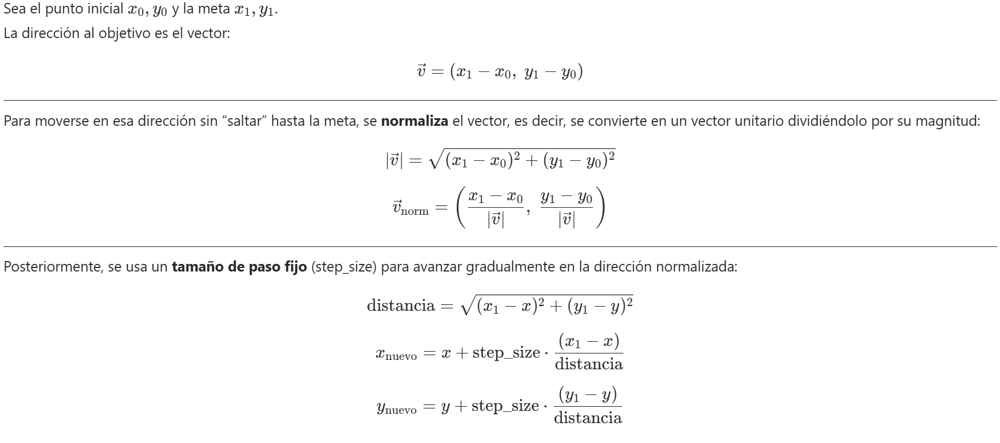
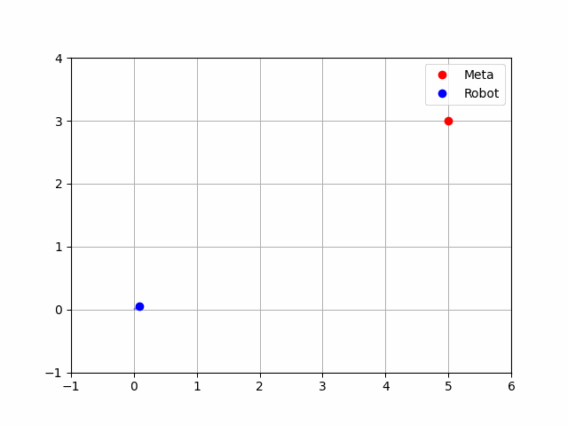

Tutoriales
==========

Creación de un espacio de trabajo
---------------------------------

A continuación, se realiza la creación de un espacio de trabajo
denominado ``ros2_ws``

**Creación del espacio de trabajo**

.. code:: bash

   mkdir -p ~/ros2_ws/src
   cd ~/ros2_ws
   colcon build
   source install/setup.bash

.. note::

   En una terminal nueva, carga primero ``/opt/ros/jazzy/setup.bash``
   y, después de compilar, ``~/ros2_ws/install/setup.bash``.
   Evita cargar automáticamente varios workspaces en ``~/.bashrc``.

--------------

Creación Paquetes
-----------------

Una vez construido el espacio de trabajo, se debe realizar la
construcción de un paquete de ROS2, en este caso se utilizará un paquete
compatible con python, y tendrá las dependencias de ``std_msgs``

1. Crear el paquete

.. code:: bash

   cd ~/ros2_ws/src
   ros2 pkg create mi_pkg_python --build-type ament_python --dependencies rclpy std_msgs

2. Estructura generada

::

   mi_pkg_python/
   ├── mi_pkg_python/
   │   └── __init__.py
   ├── package.xml
   ├── resource/
   │   └── mi_pkg_python
   ├── setup.py
   ├── setup.cfg
   └── test/

3. Compilar el paquete

.. code:: bash

   cd ~/ros2_ws
   colcon build --packages-select mi_pkg_python

Nodos
------

Una vez compilado el paquete, se realiza la creación de los nodos
publicador y suscriptor.

1. Crear el archivo del nodo publicador

.. code:: bash

   cd ~/ros2_ws/src/mi_pkg_python
   touch mi_pkg_python/publicador.py mi_pkg_python/suscriptor.py

2. Agregar el código

.. tabs::

   .. group-tab:: publicador.py

      .. code-block:: python

         # Importa la librería principal de ROS 2 en Python
         import rclpy

         # Importa la clase base Node, que representa un nodo en ROS 2
         from rclpy.node import Node

         # Importa el tipo de mensaje estándar String del paquete std_msgs
         from std_msgs.msg import String

         # Define una clase que extiende Node, representando un nodo que publica mensajes
         class MinimalPublisher(Node):

               def __init__(self):
                  # Llama al constructor de la clase padre (Node) con el nombre del nodo
                  super().__init__('minimal_publisher')

                  # Crea un publicador que publica mensajes del tipo String en el topic 'topic' con una cola de 10 mensajes
                  self.publisher_ = self.create_publisher(String, 'topic', 10)

                  # Crea un temporizador que ejecuta la función `timer_callback` cada 0.5 segundos
                  self.timer = self.create_timer(0.5, self.timer_callback)

                  # Contador para numerar los mensajes
                  self.i = 0

               # Función que se ejecuta cada 0.5 segundos
               def timer_callback(self):
                  # Crea un mensaje tipo String
                  msg = String()

                  # Asigna el contenido del mensaje
                  msg.data = f'Hello World: {self.i}'

                  # Publica el mensaje en el topic
                  self.publisher_.publish(msg)

                  # Muestra por consola el mensaje publicado
                  self.get_logger().info(f'Publishing: "{msg.data}"')

                  # Incrementa el contador
                  self.i += 1

         # Punto de entrada principal del programa
         def main(args=None):
               # Inicializa el sistema de nodos de ROS 2
               rclpy.init(args=args)

               try:
                  # Instancia el nodo y empieza a ejecutarlo
                  node = MinimalPublisher()

                  # Mantiene al nodo activo, escuchando eventos y timers
                  rclpy.spin(node)

               except KeyboardInterrupt:
                  # Permite salir con Ctrl+C sin error
                  pass

               finally:
                  # Destruye el nodo de forma limpia y apaga el sistema ROS 2
                  node.destroy_node()
                  rclpy.shutdown()

         # Verifica si el archivo se está ejecutando directamente (no importado)
         if __name__ == '__main__':
               main()

   .. group-tab:: suscriptor.py

      .. code-block:: python

         # Importa la librería principal de ROS 2 para Python
         import rclpy

         # Importa la clase base para crear nodos en ROS 2
         from rclpy.node import Node

         # Importa el tipo de mensaje estándar String desde std_msgs
         from std_msgs.msg import String

         # Define una clase que hereda de Node, representa el nodo suscriptor
         class MinimalSubscriber(Node):

               # Método constructor de la clase
               def __init__(self):
                  # Inicializa el nodo con el nombre 'minimal_subscriber'
                  super().__init__('minimal_subscriber')

                  # Crea una suscripción al tópico 'topic'
                  # Tipo de mensaje: String
                  # Función de callback: self.listener_callback
                  # Tamaño de la cola: 10 mensajes
                  self.subscription = self.create_subscription(
                     String,
                     'topic',
                     self.listener_callback,
                     10)

                  # Esta línea asegura que la variable no sea optimizada por el compilador (aunque no es obligatorio en Python)
                  self.subscription

               # Función que se llama cada vez que se recibe un mensaje en el tópico
               def listener_callback(self, msg):
                  # Imprime en consola el contenido del mensaje recibido
                  self.get_logger().info('I heard: "%s"' % msg.data)

         # Función principal que lanza el nodo
         def main(args=None):
               # Inicializa el sistema de ROS 2
               rclpy.init(args=args)

               # Crea una instancia del nodo suscriptor
               minimal_subscriber = MinimalSubscriber()

               # Mantiene el nodo corriendo escuchando datos (callback se ejecutará cuando lleguen mensajes)
               rclpy.spin(minimal_subscriber)

               # Cuando se detiene (Ctrl+C o cierre), se destruye el nodo explícitamente (opcional)
               minimal_subscriber.destroy_node()

               # Finaliza la ejecución del sistema ROS 2
               rclpy.shutdown()

         # Esta verificación permite que el nodo se ejecute solo si el script se corre directamente
         if __name__ == '__main__':
               main()

3. Registrar los nodos en ``setup.py``

.. code:: python

   entry_points={
       'console_scripts': [
           'publicador1 = mi_pkg_python.publicador:main',
           'suscriptor1 = mi_pkg_python.suscriptor:main',
       ],
   },

4. Compilar el paquete

.. code:: bash

   cd ~/ros2_ws
   colcon build --packages-select mi_pkg_python

5. Ejecutar el nodo publicador

.. code:: bash

   ros2 run mi_pkg_python publicador1

en una terminal diferente ejecutar el nodo suscriptor

.. code:: bash

   ros2 run mi_pkg_python suscriptor1

Mensajes personalizados
-------------------------

Los mensajes personalizados permiten crear un paquete exclusivo para
generar estructuras personales de mensajes en ROS2 usando
``ament_cmake``, ademas de poder integrarlos a otros paquetes.

Antes de continuar con la generación de mensajes es necesario revisar,
que tipos de mensajes están disponibles:

.. code:: bash

   ros2 interface list | grep msg

y la revisión de los parámetros del mensaje se realiza mediante el
comand:

.. code:: bash

   ros2 interface show [tipo de mensaje]

--------------

Ahora, se va a crear un paquete llamado ``avig_msg`` que defina un
mensaje personalizado ``AprilTagPixel.msg`` con los siguientes campos:

::

   string id
   int32 posx
   int32 posy

1. Crear el paquete

Desde la carpeta ``src`` del workspace:

.. code:: bash

   ros2 pkg create avig_msg --build-type ament_cmake

Este comando genera la estructura básica del paquete ``avig_msg``.

--------------

2. Crear el mensaje personalizado

.. code:: bash

   cd avig_msg
   mkdir msg
   gedit msg/AprilTagPixel.msg

Contenido:

::

   int32 id
   float32 posx
   float32 posy
   int32 orden
   float32 dist

Este archivo define un mensaje simple para enviar datos de detección de
un tag.

--------------

3. Mensajes compuestos

Se puede crear mensajes que tengan anidada mas información en este caso
se va a crear un array de ``AprilTagPixel.msg``.

Dentro del paquete ``avig_msg``

.. code:: bash

   cd msg
   gedit AprilTagPixelArray.msg

Contenido:

::

   AprilTagPixel[] tags

4. Editar ``CMakeLists.txt``

Editar ``CMakeLists.txt`` para incluir soporte de mensajes:

.. code:: cmake

   cmake_minimum_required(VERSION 3.8)
   project(avig_msg)

   find_package(ament_cmake REQUIRED)
   find_package(rosidl_default_generators REQUIRED)
   find_package(builtin_interfaces REQUIRED)

   rosidl_generate_interfaces(${PROJECT_NAME}
     "msg/AprilTagPixel.msg"
     "msg/AprilTagPixelArray.msg"
   )

   ament_export_dependencies(rosidl_default_runtime)
   ament_package()

**¿Por qué?** - ``rosidl_default_generators`` genera los bindings del
mensaje. - ``builtin_interfaces`` se necesita para tipos como ``Time`` y
``Duration``; no es necesario para ``string`` ni ``int32``. - ``ament_export_dependencies`` permite que
otros paquetes importen estos mensajes.

--------------

5. Editar ``package.xml``

Agregar las dependencias necesarias:

.. code:: xml

   <buildtool_depend>ament_cmake</buildtool_depend>
   <build_depend>rosidl_default_generators</build_depend>
   <exec_depend>rosidl_default_runtime</exec_depend>
   <member_of_group>rosidl_interface_packages</member_of_group>

**¿Por qué?** Estas etiquetas aseguran que el sistema de compilación de
ROS 2 reconozca este paquete como generador de interfaces.

--------------

6. Compilar e instalar

Desde la raíz del workspace:

.. code:: bash

   cd ~/ros2_ws
   colcon build --packages-select avig_msg
   source install/setup.bash

--------------

7. Verificar el mensaje

.. code:: bash

   ros2 interface show avig_msg/msg/AprilTagPixel

--------------

8. Usar el mensaje en otro paquete

En el paquete creado anteriormente de Python ``mi_pkg_python``:

En ``package.xml``:

.. code:: xml

   <exec_depend>avig_msg</exec_depend>

En el código Python:

.. code:: python

   from avig_msg.msg import AprilTagPixel

Se puede usar en un publicador o suscriptor como cualquier otro mensaje.

April-Tags
-----------

Un **AprilTag** es un tipo de marcador visual 2D diseñado para permitir
la detección robusta, precisa y rápida en entornos de visión por
computadora y robótica. Fue desarrollado en el Laboratorio de Robótica
de la Universidad de Michigan.

**Características principales:**

- Patrón en blanco y negro con bordes codificados.
- Cada tag tiene un **ID único**.
- Puede ser detectado desde distintos ángulos y con iluminación variable.
- Su detección es **más rápida y robusta** que QR o ARTags para propósitos robóticos.

--------------

**Usos comunes de AprilTags en Robótica**

+-----------------+----------------------------------------------------+
| Aplicación      | Descripción                                        |
+=================+====================================================+
| Localización    | Identificar una posición fija en el mapa mediante  |
| absoluta        | un tag conocido.                                   |
+-----------------+----------------------------------------------------+
| Seguimiento     | Seguir la posición de un tag en tiempo real        |
| de objetos      | (e.g. manipulación, drones).                       |
+-----------------+----------------------------------------------------+
| Calibración     | Calibrar parámetros intrínsecos y extrínsecos de   |
| de cámaras      | una cámara.                                        |
+-----------------+----------------------------------------------------+
| Interacción     | Identificar objetos, posiciones, o áreas           |
| humano-robot    | accesibles visualmente.                            |
+-----------------+----------------------------------------------------+

--------------

**Librería usada**

| Usamos la librería ``pupil_apriltags``, una implementación rápida del
  detector.
| Es eficiente, moderna, y puede ser utilizada en aplicaciones en tiempo
  real.

El resto de aplicaciones de AprilTag se puede revisar en los siguintes
repositorios:

`April-Tags <https://ftc-docs.firstinspires.org/en/latest/apriltag/vision_portal/apriltag_intro/apriltag-intro.html>`__
`Git-hub-Tags <https://github.com/rgov/apriltag-pdfs/tree/main/tag36h11/us_letter/100mm>`__

**Instalación:**

.. code:: bash

   sudo apt install python3-pip -y
   /usr/bin/python3 -c "import cv2, numpy; print('OpenCV:', cv2.__version__); print('NumPy:', numpy.__version__)"
   /usr/bin/python3 -m pip install \
    --user \
    --break-system-packages \
    --no-deps \
    "pupil-apriltags==1.0.4.post11"
   
   /usr/bin/python3 -m pip show pupil-apriltags

--------------

Configuración de la Camara.

1. Identificar las cámaras disponibles en Ubuntu

.. code:: bash

   ls /dev/video*

2. Instalar herramientas para identificar la cámara

Ubuntu dispone de una herramienta llamada v4l2-ctl, que permite consultar los dispositivos de vídeo.

.. code:: bash

   sudo apt update
   sudo apt install -y v4l-utils

revisión:

.. code:: bash

   v4l2-ctl --list-devices

Para comprobar qué dispositivo admite realmente captura de vídeo:

.. code:: bash

   v4l2-ctl -d /dev/video0 --all

En los reusltados debe existir una capacidad similar a Video Capture. Si el dispositivo solamente informa Metadata Capture, 
no será el dispositivo adecuado para capturar imágenes con OpenCV.

También puedes conocer las resoluciones y los formatos compatible

.. code:: bash

   v4l2-ctl -d /dev/video0 --list-formats-ext

3. Detectar automáticamente el ID correcto mediante Python

.. code:: bash

   python3 - <<'PY'
   import cv2
   import glob

   dispositivos = sorted(glob.glob('/dev/video*'))

   print("Buscando cámaras disponibles...\n")

   for dispositivo in dispositivos:
      print(f"Probando: {dispositivo}")

      cap = cv2.VideoCapture(dispositivo, cv2.CAP_V4L2)

      if cap.isOpened():
         ret, frame = cap.read()

         if ret and frame is not None:
               alto, ancho = frame.shape[:2]

               print("  Cámara funcional")
               print(f"  Resolución: {ancho}x{alto}")
               print(f"  Dispositivo: {dispositivo}\n")
         else:
               print("  Abre, pero no entrega imágenes\n")
      else:
         print("  No se pudo abrir\n")

      cap.release()

   print("Verificación finalizada.")
   PY

Ejemplos 

.. tabs::

   .. group-tab:: Programa 1

      *Detección en Python puro (sin ROS)*

      .. code-block:: python

         import cv2
         from pupil_apriltags import Detector

         def main():
            # Abre la cámara (0 = cámara predeterminada)
            cap = cv2.VideoCapture(0)

            if not cap.isOpened():
               print("No se pudo acceder a la cámara.")
               return

            # Configurar el detector de AprilTags
            at_detector = Detector(
               families='tag36h11',
               nthreads=1,
               quad_decimate=1.0,
               quad_sigma=0.0,
               refine_edges=True,
               decode_sharpening=0.25,
               debug=False
            )

            # Nombre de la ventana
            window_name = 'AprilTag Detector - tag36h11'

            # Hacer la ventana redimensionable
            cv2.namedWindow(window_name, cv2.WINDOW_NORMAL)
            cv2.resizeWindow(window_name, 800, 600)  # Ancho x Alto en píxeles

            print("Cámara activa. Presiona 'q' para salir.")

            while True:
               ret, frame = cap.read()
               if not ret:
                     print("No se pudo leer el frame.")
                     break

               # Convertir imagen a escala de grises
               gray = cv2.cvtColor(frame, cv2.COLOR_BGR2GRAY)

               # Detectar etiquetas AprilTag
               detections = at_detector.detect(gray)

               for detection in detections:
                     tag_id = detection.tag_id
                     print(f"Tag detectado: {tag_id}")

                     # Dibujar un círculo en el centro del tag
                     center = (int(detection.center[0]), int(detection.center[1]))
                     cv2.circle(frame, center, 10, (0, 255, 0), 2)

               # Mostrar imagen con detecciones
               cv2.imshow(window_name, frame)

               # Salir si se presiona la tecla 'q'
               if cv2.waitKey(1) & 0xFF == ord('q'):
                     break

            # Liberar recursos
            cap.release()
            cv2.destroyAllWindows()
            print("Cámara cerrada.")

         if __name__ == '__main__':
            main()

   .. group-tab:: Programa 2
   
      *Nodo ROS 2 que publica detección de AprilTags*

      Para el siguiente nodo, se utulizará los mensajes previamente creados ``AprilTagPixel`` y ``AprilTagPixelArray``.
      Este nodo se ejecuta en ROS 2 y **publica los datos detectados** (ID y posición en píxeles) en un tópico llamado ``/apriltag_pixels``.

      .. code-block:: python

         import cv2
         from pupil_apriltags import Detector
         import rclpy
         from rclpy.node import Node

         from std_msgs.msg import String
         from avig_msg.msg import AprilTagPixel, AprilTagPixelArray

         class AprilTagPixelPublisher(Node):
               def __init__(self):
                  super().__init__('apriltag_pixel_publisher')

                  self.publisher_data = self.create_publisher(AprilTagPixelArray, 'apriltag_pixels_arreglo', 1)

                  self.cap = cv2.VideoCapture(0)
                  self.cap.set(cv2.CAP_PROP_FRAME_WIDTH, 640)
                  self.cap.set(cv2.CAP_PROP_FRAME_HEIGHT, 480)
                  self.cap.set(cv2.CAP_PROP_FPS, 30)

                  if not self.cap.isOpened():
                     self.get_logger().error("No se pudo acceder a la cámara.")
                     exit()

                  self.at_detector = Detector(families='tag36h11', nthreads=4)

                  # Crear ventana redimensionable (solo si se usa visualización)
                  cv2.namedWindow("AprilTag View", cv2.WINDOW_NORMAL)
                  cv2.resizeWindow("AprilTag View", 800, 600)

                  self.timer = self.create_timer(1.0 / 30.0, self.timer_callback)
                  self.get_logger().info("Nodo AprilTag iniciado.")

               def timer_callback(self):
                  ret, frame = self.cap.read()
                  if not ret:
                     self.get_logger().warning(" No se pudo leer el frame.")
                     return

                  gray = cv2.cvtColor(frame, cv2.COLOR_BGR2GRAY)
                  detections = self.at_detector.detect(gray)

                  msg_arreglo = AprilTagPixelArray()
                  for det in detections:
                     tag_id = det.tag_id
                     center_px = det.center
                     msg = AprilTagPixel()
                     msg.id = tag_id
                     msg.posx = float(center_px[0])
                     msg.posy = float(center_px[1])
                     msg_arreglo.tags.append(msg)
                  self.publisher_data.publish(msg_arreglo)
                  # Visualizacion
                  self.visualizar_detecciones(frame, detections)

               def visualizar_detecciones(self, frame, detections):
                  """Muestra la imagen con círculos e ID de tags detectados."""
                  for det in detections:
                     center = (int(det.center[0]), int(det.center[1]))
                     cv2.circle(frame, center, 8, (0, 255, 0), 2)
                     cv2.putText(frame, f"ID:{det.tag_id}", (center[0] + 10, center[1] - 10),
                                 cv2.FONT_HERSHEY_SIMPLEX, 0.6, (255, 0, 0), 2)

                  cv2.imshow("AprilTag View", frame)
                  if cv2.waitKey(1) & 0xFF == ord('q'):
                     self.get_logger().info(" 'q' presionado. Saliendo.")
                     self.cap.release()
                     cv2.destroyAllWindows()
                     rclpy.shutdown()

               def destroy_node(self):
                  self.cap.release()
                  cv2.destroyAllWindows()
                  super().destroy_node()

         def main(args=None):
               rclpy.init(args=args)
               node = AprilTagPixelPublisher()
               try:
                  rclpy.spin(node)
               except KeyboardInterrupt:
                  node.destroy_node()
                  rclpy.shutdown()

         if __name__ == '__main__':
               main()

   .. group-tab:: Programa 3

      Se puede utilizar diferentes variaciones para uso de apriltags con ROS2,
      para poder usar un formato compatible con las imágenes de ROS se debe utilizar el tipo de mensaje ``sensor_msgs`` y agregar esta dependencia
      en el paquete creado.

      .. code-block:: python

         import cv2
         from pupil_apriltags import Detector
         import rclpy
         from rclpy.node import Node
         from avig_msg.msg import AprilTagPixel, AprilTagPixelArray
         from sensor_msgs.msg import Image

         from cv_bridge import CvBridge

         class AprilTagPixelPublisher(Node):
               def __init__(self):
                  super().__init__('apriltag_pixel_publisher')

                  # Publicador para ID y coordenadas en píxeles (bruto)
                  self.publisher_data = self.create_publisher(AprilTagPixelArray, 'apriltag_pixels', 1)
                  # Publicador para imagen tipo image_raw
                  self.publisher_image = self.create_publisher(Image, 'image_raw', 1)
                  self.bridge = CvBridge()

                  # Configurar cámara
                  self.cap = cv2.VideoCapture(0)
                  self.cap.set(cv2.CAP_PROP_FRAME_WIDTH, 1280)
                  self.cap.set(cv2.CAP_PROP_FRAME_HEIGHT, 720)
                  self.cap.set(cv2.CAP_PROP_FPS, 30)

                  if not self.cap.isOpened():
                     self.get_logger().error("No se pudo acceder a la cámara.")
                     exit()

                  # Configurar detector de AprilTags
                  self.at_detector = Detector(families='tag36h11', nthreads=4)

                  # Temporizador a 30 Hz
                  self.timer = self.create_timer(1.0 / 30.0, self.timer_callback)
                  self.get_logger().info("Nodo de detección AprilTag iniciado (modo simple sin calibración).")

               def timer_callback(self):
                  ret, frame = self.cap.read()
                  if not ret:
                     self.get_logger().warning("No se pudo leer el frame.")
                     return

                  gray = cv2.cvtColor(frame, cv2.COLOR_BGR2GRAY)
                  detections = self.at_detector.detect(gray)
                  msg_arreglo = AprilTagPixelArray()

                  for det in detections:
                     tag_id = det.tag_id
                     center_px = det.center  # coordenadas (x, y) en píxeles
                     msg = AprilTagPixel()
                     msg.id = tag_id
                     msg.posx = float(center_px[0])
                     msg.posy = float(center_px[1])
                     msg_arreglo.tags.append(msg)

                  self.publisher_data.publish(msg_arreglo)

                  # Publicar la imagen como sensor_msgs/Image
                  img_msg = self.bridge.cv2_to_imgmsg(frame, encoding='bgr8')
                  self.publisher_image.publish(img_msg)

               def destroy_node(self):
                  self.cap.release()
                  super().destroy_node()

         def main(args=None):
               rclpy.init(args=args)
               node = AprilTagPixelPublisher()
               try:
                  rclpy.spin(node)
               except KeyboardInterrupt:
                  node.destroy_node()
                  rclpy.shutdown()

         if __name__ == '__main__':
               main()

Servicios personalizados
-------------------------

En el servicio personalizado se agrega la funcionalidad de una
Heuristica al sistema de control del robot.

**Definición general** Una heurística es una regla, método o estrategia
que simplifica la toma de decisiones y permite encontrar soluciones
aproximadas en situaciones complejas, donde el cálculo exacto sería muy
costoso o imposible.

Para ello, se establece un servicio que tiene como requerimiento el tipo
de mensaje ``AprilTagPixelArray`` y como respuesta un ``AprilTagPixel``

1. Creación del archivo srv

Dentro del paquete ``avig_msg``

.. code:: bash

   mkdir srv
   cd srv
   gedit Heuristica.srv

Contenido:

::

   avig_msg/AprilTagPixelArray tags_in
   ---
   avig_msg/AprilTagPixel tag_out

Esto indica que el servicio recibirá una lista de tags y devolverá solo
uno como resultado.

--------------

2. Configurar CMakeLists.txt

Agrega lo siguiente si no está presente:

.. code:: cmake

   find_package(rosidl_default_generators REQUIRED)

Agrega todos los archivos ``.msg`` y ``.srv``:

.. code:: cmake

   rosidl_generate_interfaces(${PROJECT_NAME}
     "msg/AprilTagPixel.msg"
     "msg/AprilTagPixelArray.msg"
     "srv/Heuristica.srv"
     DEPENDENCIES builtin_interfaces
   )

revisar que se encuentren exportadas las dependencias:

.. code:: cmake

   ament_export_dependencies(rosidl_default_runtime)

--------------

3. Configurar package.xml

Incluye los siguientes bloques:

.. code:: xml

   <buildtool_depend>ament_cmake</buildtool_depend>
   <build_depend>rosidl_default_generators</build_depend>
   <exec_depend>rosidl_default_runtime</exec_depend>
   <member_of_group>rosidl_interface_packages</member_of_group>

--------------

4. Compilar

Desde la raíz del workspace:

.. code:: bash

   colcon build --packages-select avig_msg
   source install/setup.bash

Verifica el servicio:

.. code:: bash

   ros2 interface show avig_msg/srv/Heuristica

--------------

5. Crear el Servidor

Dentro del paquete ``mi_pkg_python``

.. code:: bash

   mkdir servicios
   cd servicios
   touch __initi__.py

Guarda el siguiente código como ``srv_servidor.py`` y ``srv_cliente.py``:

.. tabs::

   .. group-tab:: srv_servidor.py

      .. code:: python

         import rclpy
         from rclpy.node import Node
         from avig_msg.srv import Heuristica
         from avig_msg.msg import AprilTagPixel
         import math

         class EuristicaServer(Node):
            def __init__(self):
               super().__init__('euristica_server')
               self.srv = self.create_service(Heuristica, 'Heuristica', self.heuristica_callback)
               self.get_logger().info('Servicio Euristica listo.')

            def heuristica_callback(self, request, response):
               tags = request.tags_in.tags
               self.get_logger().info(f"Recibidos {tags} tags.")

               if not tags:
                     self.get_logger().warning("No se recibió ningún tag.")
                     return response
               
               tag1 = next((tag for tag in tags if tag.id == 1), None)
               tag2 = next((tag for tag in tags if tag.id == 2), None)

               if tag1 is None or tag2 is None:
                     self.get_logger().warning("Faltan tag1 o tag2, no se puede continuar.")
                     return response

               tags_ordenados = [tag for tag in tags if tag.id != 0 and tag.id != 1 and tag.id != 2]
               
               for i, tag in enumerate(tags_ordenados):
                     self.get_logger().info(f"Revisando el tag: {tag.id}")
                     if 10 <= tag.id < 20:
                        tag.dist = math.sqrt((tag.posx - tag1.posx)**2 + (tag.posy - tag1.posy)**2)
                     else:
                        tag.dist = math.sqrt((tag.posx - tag2.posx)**2 + (tag.posy - tag2.posy)**2)
                     
                     self.get_logger().info(f"Distancia del Tag: {tag.id} es {tag.dist}")
                     
               # Heurística: devolver el tag con menor coordenada posx
               tag_ordenado = sorted(tags_ordenados, key=lambda t: t.dist)[0]
               response.tag_out = tag_ordenado
               self.get_logger().info(f"Tag elegido: {tag_ordenado.id}")
               return response

         def main(args=None):
            rclpy.init(args=args)
            node = EuristicaServer()
            rclpy.spin(node)
            rclpy.shutdown()

         if __name__ == '__main__':
            main()

   .. group-tab:: srv_cliente.py

      .. code:: python

         import rclpy
         from rclpy.node import Node

         from avig_msg.srv import Heuristica
         from avig_msg.msg import AprilTagPixel, AprilTagPixelArray

         class EuristicaClient(Node):
            def __init__(self):
               super().__init__('euristica_client')
               self.client = self.create_client(Heuristica, 'Heuristica')

               while not self.client.wait_for_service(timeout_sec=1.0):
                     self.get_logger().info('Esperando al servicio...')

               # Crear solicitud con varios tags
               msg_array = AprilTagPixelArray()
               for i in range(10, 19, 1):
                     tag = AprilTagPixel()
                     tag.id = i
                     tag.posx = float(100 - i*10)
                     tag.posy = float(50  + i*10)
                     msg_array.tags.append(tag)
               
               tag = AprilTagPixel()
               tag.id = 1
               tag.posx = -20.0
               tag.posy = 170.0
               msg_array.tags.append(tag)

               tag = AprilTagPixel()
               tag.id = 2
               tag.posx = 105.2
               tag.posy = 23.5
               msg_array.tags.append(tag)

               request = Heuristica.Request()
               request.tags_in = msg_array

               self.future = self.client.call_async(request)

         def main(args=None):
            rclpy.init(args=args)
            node = EuristicaClient()

            while rclpy.ok():
               rclpy.spin_once(node)
               if node.future.done():
                     try:
                        response = node.future.result()
                        node.get_logger().info(f"Tag seleccionado: {response.tag_out}")
                                                
                        node.get_logger().info(f"Tag ID: {response.tag_out.id} "
                                                f"({response.tag_out.posx:.1f}, {response.tag_out.posy:.1f})")
                     except Exception as e:
                        node.get_logger().error(f"Error al llamar al servicio: {e}")
                     break

            rclpy.shutdown()

         if __name__ == '__main__':
            main()

El nodo servidor

- Responde a solicitudes del servicio ``Heuristica`` 

- Elige el tag con menor distancia al tag 1 o al tag 2 (``dist``)

El nodo cliente: 

- Crea y envía una lista de ``AprilTagPixel`` 

- Solicita una respuesta del servidor 

- Muestra el tag seleccionado

--------------

6. Registrar los nodos en setup.py

En tu ``setup.py`` agrega:

.. code:: python

   entry_points={
       'console_scripts': [
           'servidor = mi_pkg_python.srv_servidor:main',
           'cliente = mi_pkg_python.srv_cliente:main',
       ],
   },

7. Compilar el paquete 

8. Ejecutar

En dos terminales diferentes:  

.. code:: bash
   
   ros2 run mi_pkg_python servidor
   ros2 run mi_pkg_python cliente

Acciones personalizadas
-------------------------

En esta **acción personalizada** llamada ``MoverA`` se simula el movimiento de un robot hacia una posición ``(x, y)`` objetivo, utilizando el sistema de 
acciones de ROS 2.

La acción representa como el robot se mueve gradualmente en línea recta hacia 
la meta, acercándose poco a poco hasta que la distancia sea menor a un umbral (por ejemplo, 0.1).

La trayectoría que se simulará en este ejercicio obedece los siguientes puntos:

|mat| 

|gif|

**Estructura general**

- **Paquete de mensajes:** ``avig_msg``
- **Archivo de acción:** ``MoverA.action``
- **Paquete de código (cliente/servidor):** ``mi_pkg_python``

--------------

1. Definición de ``MoverA.action``

Ubicar en ``avig_msg/action/MoverA.action``:

::

   # Objetivo
   float32 x_actual
   float32 y_actual
   float32 x_meta
   float32 y_meta

   ---
   # Resultado
   bool success
   ---
   # Feedback
   float32 distancia_restante

--------------

2. Configurar ``CMakeLists.txt`` en ``avig_msg``

Agregar:

::

   find_package(rosidl_default_generators REQUIRED)

   # Agrega "action/MoverA.action" al bloque de generación existente
   # (consulta el ejemplo completo más abajo).

   ament_export_dependencies(rosidl_default_runtime)

--------------

3. Configurar ``package.xml`` en ``avig_msg``

Agregar:

.. code:: xml

   <buildtool_depend>ament_cmake</buildtool_depend>
   <build_depend>rosidl_default_generators</build_depend>
   <exec_depend>rosidl_default_runtime</exec_depend>
   <member_of_group>rosidl_interface_packages</member_of_group>

--------------

4. Crear el servidor y cliente de la acción

En ``~/ros2_ws/src/mi_pkg_python/mi_pkg_python/`` crea los archivos
``action_server.py`` y ``action_client.py``. El servidor publica feedback
hasta alcanzar la meta o recibir una cancelación. Se utiliza
``asyncio.sleep`` para evitar llamar a ``rclpy.spin_once`` desde un callback
que ya está gestionado por el ejecutor de ROS 2.

.. tabs::

   .. group-tab:: action_server.py

      .. code-block:: python

         import math
         import time

         # Componentes principales de ROS 2.
         import rclpy
         from rclpy.node import Node
         from rclpy.action import ActionServer, GoalResponse, CancelResponse
         from rclpy.callback_groups import ReentrantCallbackGroup
         from rclpy.executors import MultiThreadedExecutor

         # Acción definida en el paquete de interfaces avig_msg.
         from avig_msg.action import MoverA

         class MoverAServer(Node):
            """Nodo que recibe metas (x, y) y simula su ejecución."""

            def __init__(self):
               # Nombre con el que aparecerá el nodo en 'ros2 node list'.
               super().__init__('movera_server')

               # Permite que los callbacks de ejecución y de cancelación se atiendan
               # concurrentemente cuando se utilice un MultiThreadedExecutor.
               self._callback_group = ReentrantCallbackGroup()

               # 'mover_a' es el nombre de la acción; debe coincidir con el cliente.
               # Los tres callbacks resuelven etapas diferentes del ciclo de vida:
               # aceptar la meta, aceptar la cancelación y ejecutar el movimiento.
               self._action_server = ActionServer(
                     self,
                     MoverA,
                     'mover_a',
                     execute_callback=self.execute_callback,
                     goal_callback=self.goal_callback,
                     cancel_callback=self.cancel_callback,
                     callback_group=self._callback_group
               )

               self.get_logger().info('Servidor de la acción /mover_a listo.')

            def goal_callback(self, goal_request):
               """Decide si el servidor acepta la nueva meta recibida."""
               self.get_logger().info(
                     'Meta recibida: '
                     f'({goal_request.x_actual:.2f}, {goal_request.y_actual:.2f}) -> '
                     f'({goal_request.x_meta:.2f}, {goal_request.y_meta:.2f})'
               )

               # En esta práctica se aceptan todas las metas.
               # En un robot real habría que validar límites y rechazar conflictos.
               return GoalResponse.ACCEPT

            def cancel_callback(self, goal_handle):
               """Autoriza la solicitud de cancelación emitida por el cliente."""
               self.get_logger().info('Solicitud de cancelación recibida.')

               # ACCEPT autoriza la cancelación, pero NO termina la acción por sí solo.
               # execute_callback debe detectar la solicitud y llamar a canceled().
               return CancelResponse.ACCEPT

            def execute_callback(self, goal_handle):
               """Ejecuta la simulación y devuelve el resultado final de la meta."""

               # Los valores vienen dentro de la petición de la acción MoverA.Goal.
               # Se guardan en variables LOCALES: una ejecución no pisa los datos de
               # otra (aunque este ejemplo no modela un robot con varias metas reales).
               x_actual = float(goal_handle.request.x_actual)
               y_actual = float(goal_handle.request.y_actual)
               x_meta = float(goal_handle.request.x_meta)
               y_meta = float(goal_handle.request.y_meta)

               # Parámetros de la simulación: 0.1 unidades cada 0.5 segundos.
               paso = 0.1
               periodo = 0.5
               tolerancia = 0.1  # Distancia máxima para considerar alcanzada la meta.

               # Mensajes tipados definidos por MoverA.action:
               # Feedback.distancia_restante y Result.success.
               feedback = MoverA.Feedback()
               resultado = MoverA.Result()

               self.get_logger().info(
                     f'Iniciando: ({x_actual:.2f}, {y_actual:.2f}) -> '
                     f'({x_meta:.2f}, {y_meta:.2f})'
               )

               # El bucle de trabajo NO llama a rclpy.spin_once(self): el executor ya
               # se ocupa del nodo y hacerlo causaba 'Executor is already spinning'.
               while rclpy.ok():

                     # 1) Priorizar una cancelación solicitada por el cliente.
                     #    Gracias al executor multihilo, otro hilo puede procesar
                     #    cancel_callback mientras esta función está simulando pasos.
                     if goal_handle.is_cancel_requested:
                        goal_handle.canceled()  # Estado terminal: CANCELED.
                        resultado.success = False
                        self.get_logger().warn('Movimiento cancelado por el cliente.')
                        return resultado

                     # 2) Vector desde la posición actual hacia la meta.
                     dx = x_meta - x_actual
                     dy = y_meta - y_actual

                     # Distancia euclidiana: sqrt(dx² + dy²).
                     distancia = math.hypot(dx, dy)

                     # 3) Comprobar si ya alcanzamos la tolerancia de llegada.
                     if distancia <= tolerancia:
                        goal_handle.succeed()  # Estado terminal: SUCCEEDED.
                        resultado.success = True
                        self.get_logger().info('Objetivo alcanzado.')
                        return resultado

                     # 4) Avanzar en línea recta hacia B sin sobrepasarla.
                     #    dx/distancia y dy/distancia forman un vector unitario.
                     avance = min(paso, distancia)
                     x_actual += avance * dx / distancia
                     y_actual += avance * dy / distancia

                     # 5) Calcular la distancia DESPUÉS de avanzar y comunicarla.
                     restante = math.hypot(x_meta - x_actual, y_meta - y_actual)
                     feedback.distancia_restante = float(restante)
                     goal_handle.publish_feedback(feedback)
                     self.get_logger().info(f'Distancia restante: {restante:.2f}')

                     # 6) Simular el tiempo entre pasos. Bloquea únicamente el hilo
                     #    que ejecuta esta meta; NO es apropiado para control en tiempo
                     #    real de motores. La cancelación se atiende en otro hilo.
                     time.sleep(periodo)

               # Si ROS 2 se está apagando, evitar dejar la meta sin estado terminal.
               if goal_handle.is_active:
                     goal_handle.abort()
               resultado.success = False
               return resultado

         def main(args=None):
            """Inicializa ROS 2, ejecuta el servidor y libera sus recursos."""
            rclpy.init(args=args)
            node = MoverAServer()

            # Dos hilos: uno puede ejecutar el movimiento y otro atender cancelaciones.
            # El ReentrantCallbackGroup permite ejecutar sus callbacks en paralelo.
            executor = MultiThreadedExecutor(num_threads=2)
            executor.add_node(node)

            try:
               # Único punto de spin del servidor: NO usar spin_once dentro de callbacks.
               executor.spin()
            except KeyboardInterrupt:
               pass
            finally:
               executor.shutdown()
               node.destroy_node()
               if rclpy.ok():
                     rclpy.shutdown()

         if __name__ == '__main__':
            main()

   .. group-tab:: action_client.py

      .. code-block:: python

         import rclpy
         from rclpy.node import Node
         from rclpy.action import ActionClient

         # Permite distinguir SUCCEEDED, CANCELED y ABORTED (no solo el bool success).
         from action_msgs.msg import GoalStatus

         # Interfaz personalizada: debe haberse compilado el paquete avig_msg.
         from avig_msg.action import MoverA

         class MoverAClient(Node):
            """Nodo cliente que controla el ciclo de vida de una meta MoverA."""

            def __init__(self):
               super().__init__('movera_client')

               # 'mover_a' debe coincidir exactamente con el nombre del servidor.
               self._client = ActionClient(self, MoverA, 'mover_a')

               self._goal_handle = None     # Se asigna cuando el servidor acepta la meta.
               self._cancel_solicitada = False  # Impide peticiones duplicadas.
               self._terminado = False     # Señal para salir del bucle de main().

            def send_goal(self, xi, yi, xm, ym):
               """Construye y envía la meta de forma asíncrona al servidor."""

               # La clase Goal contiene los cuatro campos definidos en MoverA.action.
               goal_msg = MoverA.Goal()
               goal_msg.x_actual = float(xi)
               goal_msg.y_actual = float(yi)
               goal_msg.x_meta = float(xm)
               goal_msg.y_meta = float(ym)

               # Evita esperar indefinidamente si no se inició el servidor.
               if not self._client.wait_for_server(timeout_sec=5.0):
                     self.get_logger().error('El servidor /mover_a no está disponible.')
                     self._terminado = True
                     return

               self.get_logger().info(
                     f'Enviando meta: ({xi:.2f}, {yi:.2f}) -> ({xm:.2f}, {ym:.2f})'
               )

               # send_goal_async NO espera al final del movimiento; devuelve un Future.
               # feedback_callback recibe actualizaciones durante la ejecución.
               futuro = self._client.send_goal_async(
                     goal_msg,
                     feedback_callback=self.feedback_callback
               )

               # Cuando el servidor conteste si acepta/rechaza la meta, ejecutar el
               # método goal_response_callback para registrar el goal_handle.
               futuro.add_done_callback(self.goal_response_callback)

            def goal_response_callback(self, future):
               """Procesa la aceptación o el rechazo de la meta."""
               self._goal_handle = future.result()

               if not self._goal_handle.accepted:
                     self.get_logger().error('El servidor rechazó la meta.')
                     self._terminado = True
                     return

               self.get_logger().info('Meta aceptada. Esperando feedback y resultado.')

               # El resultado final llegará después (SUCCEEDED, CANCELED o ABORTED).
               futuro_resultado = self._goal_handle.get_result_async()
               futuro_resultado.add_done_callback(self.result_callback)

            def feedback_callback(self, feedback_msg):
               """Muestra distancia restante y solicita cancelación si corresponde."""

               # Los datos de aplicación están anidados en feedback_msg.feedback.
               distancia = feedback_msg.feedback.distancia_restante
               self.get_logger().info(f'Feedback: distancia = {distancia:.2f}')

               # Solo cancelar si la meta ya fue aceptada y no hemos pedido cancelar.
               if (
                     distancia < 0.8
                     and self._goal_handle is not None
                     and not self._cancel_solicitada
               ):
                     self._cancel_solicitada = True
                     self.get_logger().warn('Solicitando cancelación (distancia < 0.8).')

                     # Petición asíncrona de cancelación: todavía NO equivale a CANCELED.
                     futuro_cancelar = self._goal_handle.cancel_goal_async()
                     futuro_cancelar.add_done_callback(self.cancel_callback)

            def cancel_callback(self, future):
               """Indica si el servidor aceptó procesar la cancelación."""
               respuesta = future.result()

               if respuesta.goals_canceling:
                     self.get_logger().info(
                        'Cancelación aceptada; esperando estado final CANCELED.'
                     )
               else:
                     self.get_logger().warn(
                        'Cancelación no aceptada (la meta pudo terminar antes).'
                     )

            def result_callback(self, future):
               """Consulta el resultado y el ESTADO TERMINAL de la acción."""
               respuesta = future.result()
               estado = respuesta.status
               resultado = respuesta.result

               if estado == GoalStatus.STATUS_SUCCEEDED and resultado.success:
                     self.get_logger().info('Meta completada: SUCCEEDED.')
               elif estado == GoalStatus.STATUS_CANCELED:
                     self.get_logger().warn('Meta cancelada: CANCELED.')
               elif estado == GoalStatus.STATUS_ABORTED:
                     self.get_logger().error('Meta abortada por el servidor: ABORTED.')
               else:
                     self.get_logger().warn(
                        f'La acción terminó con estado={estado}, success={resultado.success}'
                     )

               # Señal para que main termine de procesar callbacks y cierre el nodo.
               self._terminado = True

         def main(args=None):
            """Inicia el cliente y procesa respuestas hasta recibir el resultado."""
            rclpy.init(args=args)
            node = MoverAClient()

            try:
               # Coordenadas de ejemplo: desde A=(3,3) hasta B=(0,0.1).
               node.send_goal(3.0, 3.0, 0.0, 0.1)

               # Aquí spin_once SÍ es válido porque está en main(), NO en un callback
               # ni dentro de otro spin concurrente para el mismo nodo.
               while rclpy.ok() and not node._terminado:
                     rclpy.spin_once(node, timeout_sec=0.1)
            except KeyboardInterrupt:
               pass
            finally:
               node.destroy_node()
               if rclpy.ok():
                     rclpy.shutdown()

         if __name__ == '__main__':
            main()

.. note::

   El servidor anterior es una simulación didáctica: acepta más de una
   meta, pero **no implementa arbitraje ni límites de movimiento** para
   controlar un robot físico. Para un actuador real, implementa exclusión
   de metas concurrentes, límites de velocidad y parada de emergencia.

5. Registrar ejecutables y dependencias

En el ``setup.py`` del paquete Python ``mi_pkg_python``, dentro de
``entry_points['console_scripts']`` registra:

.. code-block:: python

   'action_server = mi_pkg_python.action_server:main',
   'action_client = mi_pkg_python.action_client:main',

Agrega a ``package.xml`` de ``mi_pkg_python``:

.. code-block:: xml

   <exec_depend>rclpy</exec_depend>
   <exec_depend>avig_msg</exec_depend>

En ``CMakeLists.txt`` de ``avig_msg`` agrega la acción al **mismo** bloque
``rosidl_generate_interfaces`` que ya contiene mensajes y servicios.
No crees un segundo bloque para el mismo paquete:

.. code-block:: cmake

   rosidl_generate_interfaces(${PROJECT_NAME}
     "msg/AprilTagPixel.msg"
     "msg/AprilTagPixelArray.msg"
     "srv/Heuristica.srv"
     "action/MoverA.action"
   )

6. Compilar y verificar

.. code-block:: bash

   cd ~/ros2_ws
   colcon build --symlink-install --packages-up-to mi_pkg_python
   source install/setup.bash
   ros2 interface show avig_msg/action/MoverA

Ejecutar
-----------

En la primera terminal:

.. code-block:: bash

   ros2 run mi_pkg_python action_server

En la segunda terminal:

.. code-block:: bash

   ros2 run mi_pkg_python action_client

.. note::

   El servidor informa periódicamente la distancia restante. El cliente
   informa si la meta finalizó correctamente. Para verificar la
   cancelación, utiliza una variante de cliente que llame a
   ``goal_handle.cancel_goal_async()`` ante un evento del usuario.

