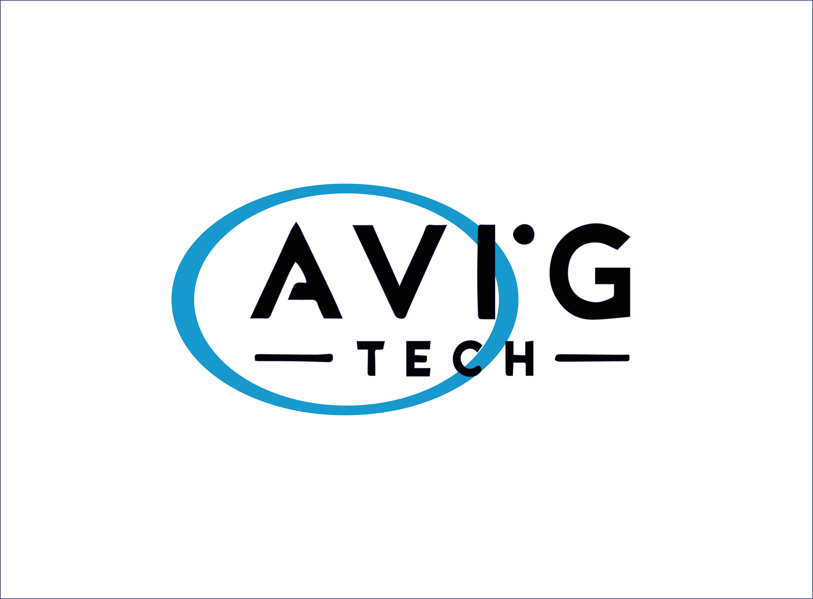

ROS 2 JAZZY: FUNDAMENTOS Y xArm 6
=================================

Bienvenido a la documentación educativa de AvigTech para **Ubuntu 24.04 LTS**
y **ROS 2 Jazzy**, con prácticas aplicadas al manipulador **UFACTORY xArm 6**.
Se conserva el material general anterior y se incorporan laboratorios que
conectan teoría, comandos, programación Python y planificación.

Contenido del curso
===================

.. toctree::
   :maxdepth: 2
   :caption: Introducción y puesta en marcha

   documentos/tema_0/intro
   documentos/tema_1/ubuntu_git
   documentos/tema_1/instalacionROS2
   documentos/tema_1/compatibilidad_jazzy
   documentos/tema_1/xarm_instalacion

.. toctree::
   :maxdepth: 2
   :caption: Fundamentos ROS 2 aplicados al xArm 6

   documentos/tema_2/conceptos_basicos
   documentos/tema_2/tutoriales
   documentos/tema_2/xarm_comunicacion
   documentos/tema_2/xarm_servicios
   documentos/tema_2/xarm_reto_resuelto

.. toctree::
   :maxdepth: 2
   :caption: Dispositivos y modelos robóticos

   documentos/tema_3/dispositivos
   documentos/tema_4/drivers
   documentos/tema_4/modelo_digital
   documentos/tema_4/gemelo_digital
   documentos/tema_4/xarm_modelo
   documentos/tema_4/xarm_moveit
   documentos/tema_4/behavior_trees

.. toctree::
   :maxdepth: 2
   :caption: Proyectos aplicados

   documentos/tema_5/xarm_integrador
   documentos/tema_5/proyecto_1
   documentos/tema_5/proyecto_2
   documentos/tema_5/extra
